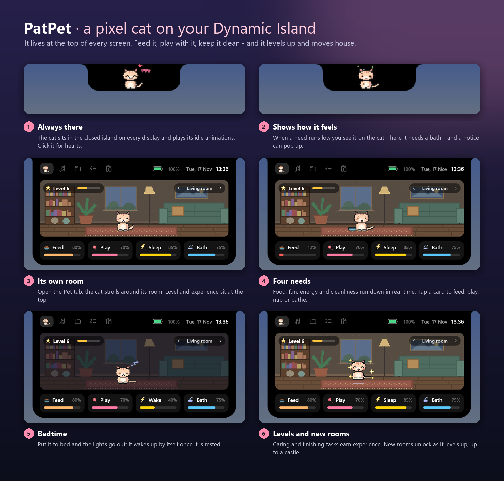

# PatPet 🐾

A lightweight Dynamic Island for Windows with a pixel-art cat living in it, written in Rust
(pure Win32 + Direct2D, no webview). Based on [Veyra](https://github.com/AhmadUlyani/Veyra);
the earlier Slint version of PatPet is kept under the git tag `v2-slint`.
Uses about 12 MB of memory and around 1% of one CPU core while the cat animates in the closed
island (only the cat's square is redrawn; buffers and idle pages are handed back to Windows a
few seconds after the island returns to its small shape). Animations are paced to the
display's refresh rate (60/120/144/165 Hz…) by waiting for vertical blank. The single `.exe` is under 1 MB.



## Features

| Tab | What it does |
| --- | --- |
| Pet | The cat's room: look after it (feed, play, sleep, bath), watch it level up and unlock new rooms. See [The cat](#the-cat). |
| Music | Shows what's playing in any player that reports to Windows media controls (Spotify, Apple Music, browsers/YouTube, …). Play/pause, previous/next, click the bar to seek. Scroll on the island to change volume. |
| Lyrics | The speech-bubble button splits the island: live synced lyrics from [lrclib.net](https://lrclib.net). Click a line to jump to it. |
| Shelf | Drag files onto the island to keep them, drag them back out into chats, emails or folders. Images show a small preview. Click a file to open it. With many files, scroll to slide through them. New screenshots (saved in Pictures\Screenshots by Win+PrtScn or the Snipping Tool) are added automatically; switch that off in the tray menu. |
| Tasks | A month calendar next to the tasks of the day you pick. Days with tasks get a dot (red: overdue). Pick a day, type a task and set a time (− / + or the mouse wheel, ±15 / ±5 min; a later day starts at 09:00), then press Enter. Scroll over the calendar to change month, click the month name to jump back to today. Today also lists tasks without a time and unfinished ones from earlier days. Reminders come 1 day, 6 hours, 3 hours, 1 hour and 30 minutes before the deadline, and when it is due. While a full-screen app is in front they stay quiet and show once it is gone. |
| Clipboard | The last 30 pieces of text you copied, newest first. Click one to copy it again (it keeps its place), or remove it with ✕. **Copy all** copies every entry at once, oldest first, one per line. Text dragged onto the island (from a browser or an editor) is added here too, without touching what is on the Windows clipboard. Kept in memory only, so the list is gone when PatPet closes, and copies that apps mark as private (password managers) are skipped. Text only, no images. |

## The cat

A small pixel cat lives in the island and follows what you are doing:

* closed island: in the middle of the empty notch, or at the left end next to the song or task
* open island: in its own **Pet** tab (its room), or in the tab bar of the other tabs
* two-line notices: at the right end

### Looking after it

The Pet tab shows the cat's room. It strolls around, grooms, wags its tail and stretches now and then.
Below the room are four cards, one per need. Each need runs down in real time; while PatPet is closed
(or the PC sleeps) food, fun and hygiene drop four times slower, and a long absence counts as at most 3 days:

| Card | Need | Empties in about | What it does |
| --- | --- | --- | --- |
| Feed | food | 14 hours | +40 food, the cat eats from its bowl |
| Play | fun | 17 hours | +30 fun, −5 energy, the cat plays with yarn and pounces |
| Sleep / Wake | energy | 16 hours awake | lights out; it sleeps until fully rested (+25 an hour), or until you wake it |
| Bath | hygiene | 33 hours | back to 100, with a bath and a shake |

With a few meals, games and a bath a day the cat stays happy all day; left alone, it gets sad within a
working day.

The cat also sleeps when you leave the PC for 5 minutes, and time PatPet is closed counts as sleep.
When a need drops below 25% the cat shows it (hungry, sad, sleepy or dirty, in the room and in the closed
island), and a gentle notice says so at most every 3 hours. Nothing worse happens: it is only sad.

**Petting:** in the closed island, move the mouse back and forth over the cat; in the open island,
click it. It jumps with joy and little hearts float up (once every 2 seconds at most).

### Breaks

After 50 minutes of work (mouse or keyboard used within the last minute) the cat stretches and suggests a
short break. Tap the notice and the closed island counts down 5 minutes while the cat naps; leave mouse and
keyboard alone for 3 of those minutes and the break counts: +20 fun and +6 experience (up to 8 breaks a day).
Let the notice go by and it asks again after 15 more minutes of work, twice at most. Skipping costs nothing:
the cat is never sad about it. Being away for 5 minutes on your own counts as a break too (the 50 minutes
start again, without a notice). It waits while a full-screen app is in front. Turn it off with
**Break reminders from the cat** in the right-click menu.

### Focus

Below the care cards, pick 15, 25, 45 or 60 minutes and press **Start**. The cat puts on its glasses and
focuses with you; the closed island counts down. Break reminders wait until the session is over. When the
time is up you get 1 experience for every 5 minutes (up to 12 a day) and a 5-minute break is offered.
**Stop** ends a session early, and the minutes already done still count. A session keeps running if PatPet
is closed in between.

### Levels and rooms

Feeding (+5), playing (+8), a bath (+5), petting (+1), a break (+6, up to 8 a day) and every task you tick off (+10, the first time only, up to 5 tasks a day) give experience;
actions only count while that need is below 95%. With everyday care the castle opens after about six weeks. Level *n* needs 40 + 20·*n* experience. Levelling up plays
a celebration and opens new rooms; switch between open rooms with the arrows at the top right of the room.

| Level | Room |
| --- | --- |
| 1 | Cardboard box |
| 3 | Bedroom |
| 5 | Living room |
| 8 | Garden |
| 12 | Treehouse |
| 16 | Castle |

| Mood | When |
| --- | --- |
| Eat, Play, Pounce, Bath, Shake, Level-up | acting out a care card or a new level |
| Happy | petted, a task ticked off, the charger plugged in |
| Sleep | put to bed, or no mouse or keyboard input for 5 minutes |
| Music | something is playing (headphones on) |
| Hungry, Sad, Sleepy, Dirty | a need is below 25% |
| Walk | strolling around its room |
| Groom, Tail wag, Stretch | now and then, when nothing else is going on |
| Yawn | now and then late at night (23:00–04:00) |
| Idle | nothing special going on |

The care state is saved with the rest of the data in `%APPDATA%\PatPet\data.json` (`pet`).
The pictures are PNGs in `assets/pet`: cat animation strips (32×32 frames side by side), `props.png`
(16×16 icons) and `rooms/` (232×70, drawn at 2×), all embedded in the exe.

System notices: volume and brightness HUD, Caps Lock, keyboard language changes,
charger plugged/unplugged, low battery, Wi-Fi connected or lost, audio output/headphones changed, text copied.
The island hides itself while a full-screen app or presentation is running.

**Several displays:** every display gets its own island, and they all show the same thing (the cat,
the song, notices). The panel opens on the display you click; clicking the island on another display
moves it there. A full-screen app only hides the island of the display it runs on. Plugging a display
in or out adds or removes its island.

On the first run after installing, **Start with Windows** and **Add screenshots to Shelf** are on.
Both can be switched off in the menu, and stay off after that.

## Install

Download `patpet.exe` from the [latest release](https://github.com/Mullet11/PatPet/releases/latest) and open it.
That's all: PatPet copies itself to `%LOCALAPPDATA%\Programs\PatPet`, starts from there and says
"PatPet is installed". From then on it starts with Windows, it is in the Start menu, and it is listed in
**Settings > Apps > Installed apps**. The downloaded file can be deleted. No admin rights are needed.

The exe is not signed, so the first time Windows may say "Windows protected your PC": click **More info**,
then **Run anyway**. (The Microsoft Store version, once published, installs without that warning.)

**Uninstall:** Settings > Apps > Installed apps > PatPet > Uninstall. It asks whether to keep your tasks,
cat and settings, then removes PatPet from Windows startup, the Start menu and its folder.

## Usage

* Click the pill to expand it (buttons react when the mouse button is released, so holding it down does nothing).
  It collapses by itself shortly after the mouse leaves it, or with `Esc` or a click outside; clicks inside
  the island never close it. It stays open while you type in a field or hold the mouse button.
* A task or clipboard entry too long for its row ends in "…"; hold the mouse over it and the text slides to show the rest.
* Right-click the island or the tray icon for **Hide / Show PatPet**, **Shrink to a line until hovered**,
  **Add screenshots to Shelf**, **Break reminders from the cat**, **Start with Windows** and **Quit**.
  Left-click the tray icon to bring a hidden island back.
* **Shrink to a line until hovered** (off by default): the closed island becomes a thin line at the top of the
  screen. Move the mouse onto the line, or within about 1 cm of it, and the normal pill comes back.
  Notices still show as usual.
* Launch it from the Start menu or Windows Search. Launching it again while it runs (or is hidden) just
  opens the island.
* Data is stored in `%APPDATA%\PatPet\data.json`.

## Updates

PatPet checks GitHub for a new release shortly after it starts and then every 6 hours. When there is one,
a notice says so (not during full-screen apps): tap it to update. The menu (right-click the island or the tray icon)
also has **Update to vX.Y.Z**, or **Check for updates** when nothing new was found yet.
The update downloads `patpet.exe` from the latest release, checks it against the SHA-256 GitHub lists for the file,
puts it in place of the running exe and restarts PatPet (settings and tasks stay). If PatPet's folder can't be written to,
the notice opens the download page instead.

Publishing a release: bump `version` in `Cargo.toml`, build, and create a GitHub release tagged `v<version>`
(e.g. `v1.5.0`) with the built `patpet.exe` attached under exactly that name.

The Microsoft Store version is updated by the Store instead: it has no update notice or menu item.

## Microsoft Store package

`packaging/` holds the MSIX manifest and tile icons. The Store signs the package, so Store users get no
"Windows protected your PC" warning. In the Store version PatPet does not install or update itself, and it
starts with Windows through the package's startup task (on after the app has been opened once; the
**Start with Windows** menu item switches it).

1. Register for free as an individual developer at storedeveloper.microsoft.com and reserve the name PatPet.
2. In `packaging/AppxManifest.xml`, replace the three `FROM-PARTNER-CENTER` values with the ones in
   Partner Center > PatPet > Product identity, and set `Version` to the release (`3.2.0.0`).
3. Build, put `target\release\patpet.exe` next to the manifest in a copy of `packaging/`, and pack it with
   the Windows SDK: `makeappx pack /d <that folder> /p PatPet.msix`.
4. Upload `PatPet.msix` in a new submission (no signing needed: the Store signs it).

While developing, `cargo`'s own builds (`target\release`) never install themselves; they run where they are.

## UI colors

Right-click the island or the tray icon → **UI colors (theme.conf)...** opens `%APPDATA%\PatPet\theme.conf`
in Notepad. Save it and PatPet applies the change within a second. Lines starting with `#` are comments.

```ini
# solid or gradient
mode = gradient
solid = #000000
# from the BOTTOM of the island (0) to the TOP (1): color position, ...
gradient = #F07A8A 0, #F2B5BC 0.45, #F2DCE0 0.75
# auto = white on dark backgrounds, dark on light ones
text = auto
# faded text (hints, labels, inactive icons): auto, normal, high, max, or 0-100
text_contrast = auto

# while the island is open: same, solid or gradient (it fades between the two)
expanded_mode = same
expanded_solid = #000000
expanded_gradient = #0A1A4A 0, #1E4FD8 0.6, #4A8BFF 1
# same, auto (picked for the open background) or a color; contrast takes text_contrast's values or same
expanded_text = auto
expanded_text_contrast = auto

# regular buttons (auto = translucent, follows the text color)
button = auto
button_hover = auto
button_text = auto
# the selected button (the open tab); not affected by button_hover
button_active = auto
# main colored buttons (add task, Deselect); auto = each feature's color
button_accent = auto
# text and icons on them; auto = black or white, whichever reads better
button_accent_text = auto

# regular icons (auto = the text color); the open tab and switched-on toggles (auto = feature color)
icon = auto
icon_active = auto

# auto = the color taken from the album art
# song progress and volume bars, the moving bars in the closed island, a lyric line under the mouse
audio_bar = auto
spectrum = auto
lyrics_hover = auto
```

* Colors are `#RGB`, `#RRGGBB` or `#RRGGBBAA` (the last two digits set transparency, e.g. `#FFFFFF66`).
* Gradient positions are optional (`#F07A8A, #F2DCE0` spreads the colors evenly); `45%` works too.
* Invalid values fall back to the default. An older `theme.json` is converted on first start
  (and kept as `theme.json.old`).
* New options are added to an existing `theme.conf` automatically; values you already set are left alone.
* On light backgrounds, built-in feature colors used for text and icons are darkened so they stay readable.

## Build

```
powershell -ExecutionPolicy Bypass -File build.ps1
```

This runs `cargo build --release`; `build.rs` embeds `assets/app.ico` and the manifest into
`target\release\patpet.exe` (plain `cargo build --release` does the same).

Or just double-click `rebuild.bat`: it closes the running PatPet, builds, and starts the new build.

For screenshots and testing, `PATPET_DEMO=pet|petroom|breakdue|breaktimer|focus|focuspanel|focusdone|pethungry|petnap|petlevel|petpill|media|lyrics|shelf|tasks|tasksday|taskremind|clipboard|clipboardempty|tasksempty|toast|volume|shelfimg|cliphover|cliphoverfull|caps|capsoff|tws|charging|copied|idle|line`
opens a specific view on start (`pet`: the happy cat with hearts; demo mode never saves data).
With `PATPET_DUMP=out.bmp` as well, the settled frame is saved to that file and PatPet quits. `PATPET_DEMO=stress` keeps opening and closing the island
to check for leaks (`PATPET_STRESS=fetch|toggle`, `PATPET_STRESS_MS`, `PATPET_STRESS_N`). `PATPET_MOUSE=x,y` pretends
the cursor rests there, to see hovers. `PATPET_DEBUG=1` writes a log to `%TEMP%\patpet.log`.
`PATPET_NO_UPDATE=1` skips the update check. `PATPET_UPDATE_FROM=1.0.0` pretends to be that version; with
`PATPET_DEMO=update` it installs the latest release right away (run a copy in a spare folder: it replaces that exe).
`patpet.exe --quit` asks a running PatPet to close (with its closing animation, saving data first).

## Tests

* `cargo test --release`: unit tests.
* `powershell -ExecutionPolicy Bypass -File tools\test_ui.ps1`: closes and reopens PatPet while measuring
  the notch on screen (closing/opening animation), and renders the Caps Lock pill to `target\test\*.png`.
* `tools\notch_watch.ps1 [seconds]`: prints the notch size on screen whenever it changes.
* `cargo run --example media_probe -- <seconds> [play]`: logs Windows media-session events with timestamps
  (with `play`: mutes the output, starts playback, and pauses + restores the mute at the end).
* `cargo run --example close_probe -- <play_s> <watch_s>`: plays muted, then logs every 50 ms the session
  status, the player's windows, processes and audio, while you close the player.
* `tools\debug_run.bat`: restarts PatPet with logging to `%TEMP%\patpet.log`.
